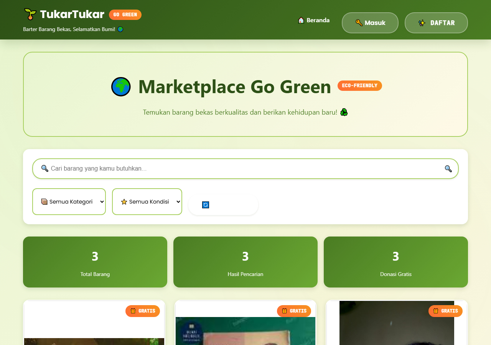
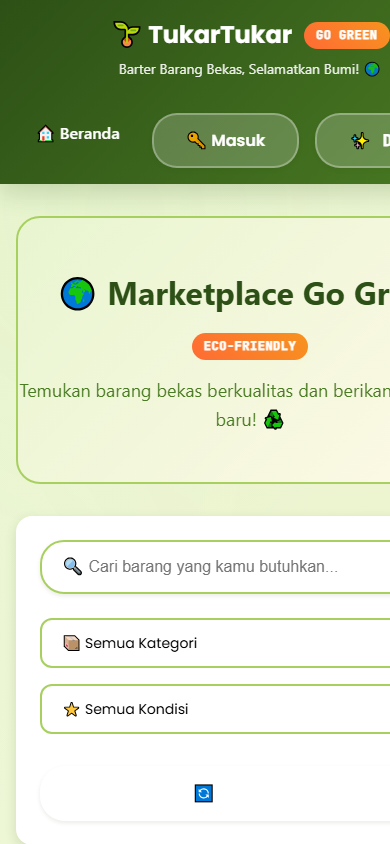
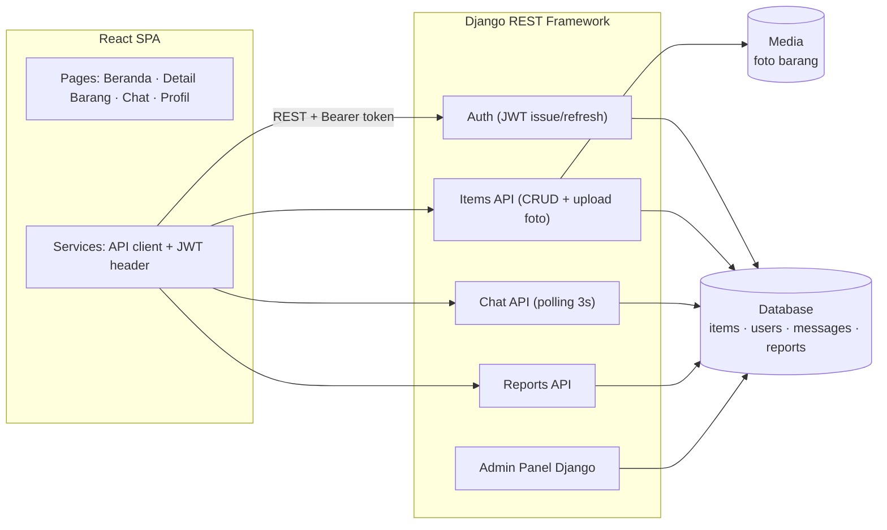

# TukarTukar — Platform Barter Barang Bekas

**Tukar barang bekas kamu dengan barang yang kamu butuhkan — tanpa uang, tanpa ribet.**

---

## Tampilan

### Desktop

### Mobile

---

## Masalahnya

- Barang bekas yang masih layak pakai sering berakhir di **tumpukan sampah** — menjual di marketplace itu ribet (foto, harga, negosiasi, ongkir)
- Barter (tukar-menukar) justru **tidak punya platformnya sendiri**
- Yang ada sekarang: group Facebook/gratisan — tanpa profil, tanpa keamanan, tanpa riwayat percakapan yang jelas

## TukarTukar

Platform barter barang bekas untuk gaya hidup berkelanjutan: **unggah barang → cari yang cocok → chat → tukar.** UI green theme yang senada dengan misi eco-friendly.

### Fitur Utama

- **Autentikasi JWT** — register/login dengan token, CORS terkonfigurasi ketat
- **Manajemen Barang (full CRUD)** — unggah foto, kondisi barang, donasi/tukar, status ketersediaan; edit hanya oleh pemilik
- **Chat antar pengguna** — real-time messaging via polling stabil (3 detik), tandai sudah-dibaca, profil terintegrasi — tanpa WebSocket/Redis yang rawan error
- **Pencarian & filter** — kategori, kondisi, kata kunci
- **Admin panel lengkap** — kelola user, barang (preview gambar), monitor percakapan, sistem laporan, statistik (views, likes, trades)
- **Responsif** — mobile-friendly untuk semua perangkat

---

## Arsitektur

- **Backend:** Django REST Framework + JWT auth, validasi input dua lapis, pagination, database indexing
- **Frontend:** React (Vite/webpack SPA), conditional UI berdasarkan ownership
- **Keamanan:** JWT, CORS ketat, file upload validation, admin panel terproteksi

---

## English

**TukarTukar** is a barter platform for used goods. You trade what you no longer use for what you need, without money changing hands.

It targets people who want to declutter and get something useful in return, rather than sell at a loss.

The source code is not published; this repository documents the product.

---

## Tentang Source Code

Repository ini adalah **showcase** — dokumentasi produk, bukan kode sumber.
Source code TukarTukar tidak dipublikasikan dan semua hak dilindungi. Lihat [`LICENSE`](LICENSE).

> Demo, kolaborasi, atau lisensi? Hubungi [Kandar Lubis](https://github.com/kandarlubis31).

---

© 2026 Kandar Lubis — All Rights Reserved.
